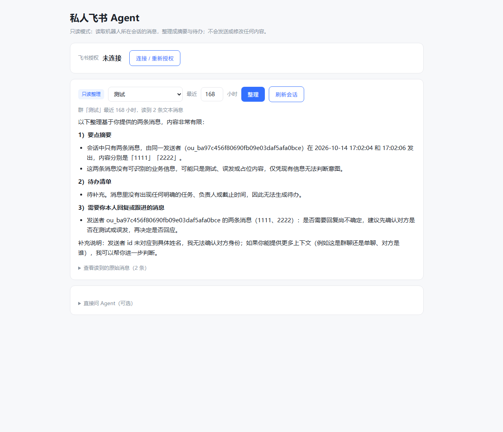

# Feishu Read-Only Digest Agent

English | [简体中文](README.md)


A small local web app that turns Feishu (Lark) group messages into a structured digest. Add the bot to a group, open the page, pick the group and a time window, and an LLM produces **key points, action items, and messages that need your reply**.

It is strictly read-only: it never sends messages, edits documents, or creates calendar events.

## Screenshot



## What it does

- Lists every group the bot belongs to
- Summarises the last N hours of messages for the selected group
- Splits the result into key points, action items, and follow-ups
- Lets you expand the raw messages it read, so you can verify the output
- Includes a small "ask the agent directly" box
- Supports `http://127.0.0.1:8000/?auto=1&hours=168` to render a digest on load

## Prerequisites

You need your own Feishu custom app:

1. App features → add the **Bot** capability
2. Permissions → enable these app-identity scopes:
   - `im:chat:readonly` — list groups the bot is in
   - `im:message:readonly` — read messages
   - `im:message.group_msg` — read group message history (sensitive scope; may require a usage note or admin approval)
3. Version management → create and publish a version (permission changes only take effect after publishing)
4. Add the bot to the group you want to digest

If a scope is missing, the API returns the exact permission link Feishu generates for it.

## Quick start

```bash
git clone https://github.com/peng0408/feishu-agent.git
cd feishu-agent
python -m pip install -r requirements.txt
cp .env.example .env      # use `copy` on Windows
python app.py
```

Then open <http://127.0.0.1:8000>.

### Configuration

| Variable | Purpose |
| --- | --- |
| `FEISHU_APP_ID` | Feishu app ID |
| `FEISHU_APP_SECRET` | Feishu app secret |
| `FEISHU_REDIRECT_URI` | OAuth callback, default `http://127.0.0.1:8000/oauth/callback` |
| `SESSION_SECRET` | Flask session signing key, any random string |
| `DEEPSEEK_API_KEY` | Model API key |
| `DEEPSEEK_BASE_URL` | OpenAI-compatible endpoint, default `https://api.deepseek.com` |
| `DEEPSEEK_MODEL` | Model name, default `deepseek-flash` |

The redirect URI must match the one configured in the Feishu console exactly.

## Usage

1. Open <http://127.0.0.1:8000>
2. Pick a group from the auto-loaded list
3. Set the time window (24 hours by default; 168 for a weekly digest)
4. Click **整理** (Summarise) and wait a few seconds
5. Expand **查看读到的原始消息** to verify what the model actually read

The **连接 / 重新授权** button is an optional user-identity OAuth flow. Digesting messages uses the app identity (`tenant_access_token`), so it works without logging in.

## API

| Method | Path | Description |
| --- | --- | --- |
| GET | `/api/agent/status` | Auth status, model name, whether the key is configured |
| GET | `/api/feishu/chats` | Groups the bot belongs to |
| GET | `/api/feishu/messages?chat_id=...&hours=24` | Raw recent messages of a chat |
| POST | `/api/agent/summarize` | `{"chat_id": "...", "hours": 24}` → digest |
| POST | `/api/agent/chat` | `{"message": "..."}` → direct model reply |

## How it works

```
tenant_access_token → GET /im/v1/chats → GET /im/v1/messages
        → build a transcript with timestamps and senders
        → POST /chat/completions (OpenAI-compatible)
        → render the digest in the browser
```

## Privacy

- Read-only by construction: no send/edit/create calls exist in the code
- Only messages from chats the bot participates in are readable — a Feishu platform limit
- `.env` is git-ignored; secrets never leave your machine
- OAuth tokens stay in the session memory, not on disk

## Limitations

- At most 50 messages per request (`page_size=50`); paginate by time window for busier groups
- The bot can only read messages sent after it joined the chat
- Senders are shown as Feishu `open_id`; resolving names needs an additional contact scope
- Runs on the Flask development server — fine for personal use, not for public deployment

## Project layout

```
feishu-agent/
├── app.py              # Flask app: OAuth, read-only Feishu APIs, model calls, UI
├── docs/
│   └── screenshot.png  # UI screenshot
├── requirements.txt
├── .env.example
├── README.md
├── README.en.md
└── LICENSE
```

## License

[MIT](LICENSE)
